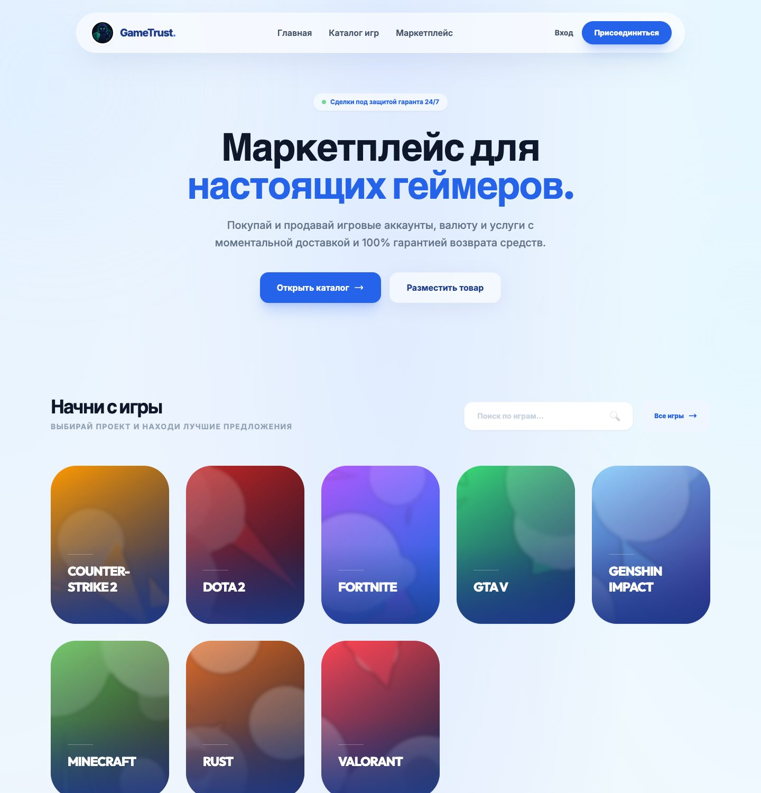
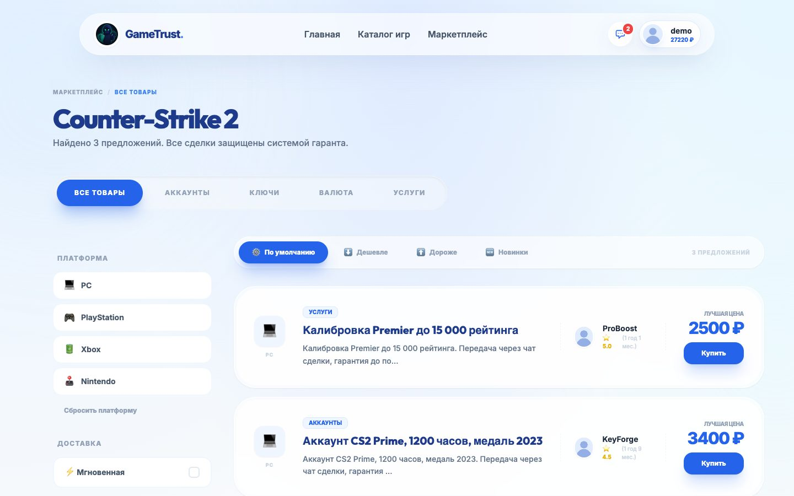
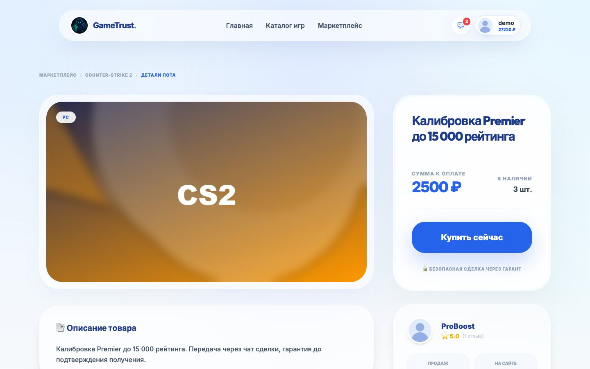
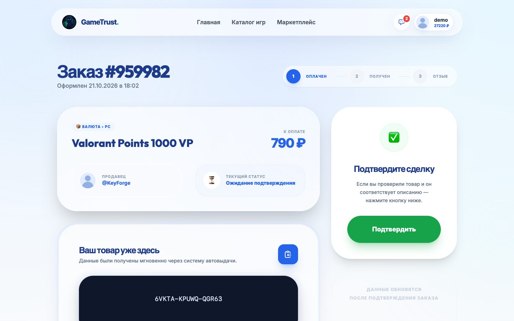
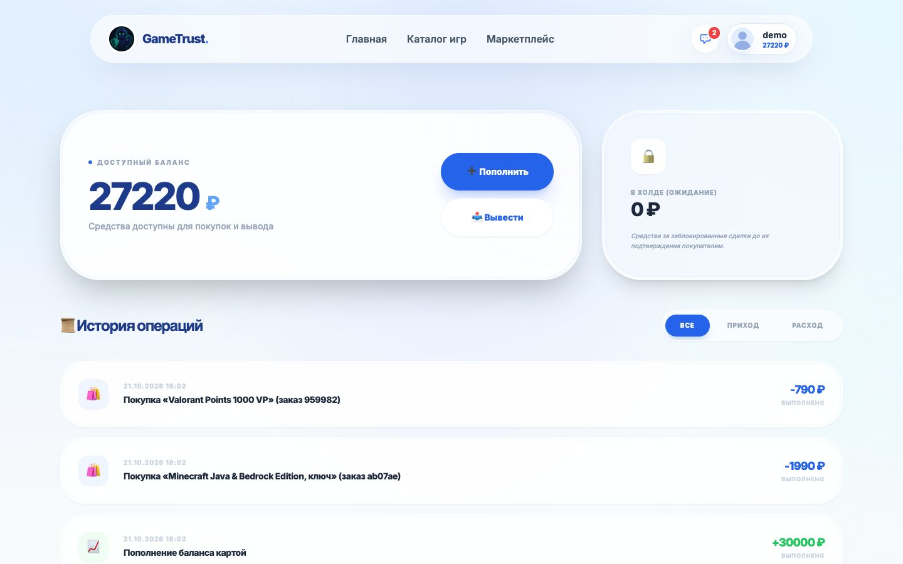
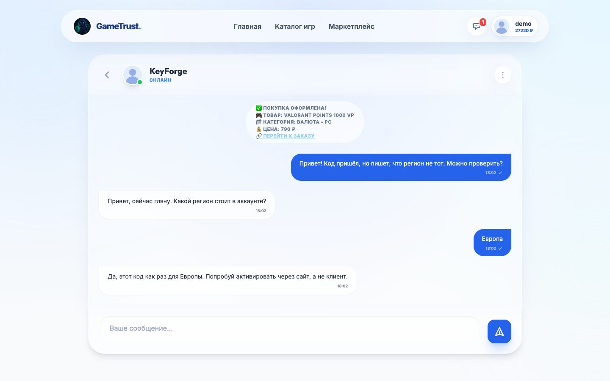
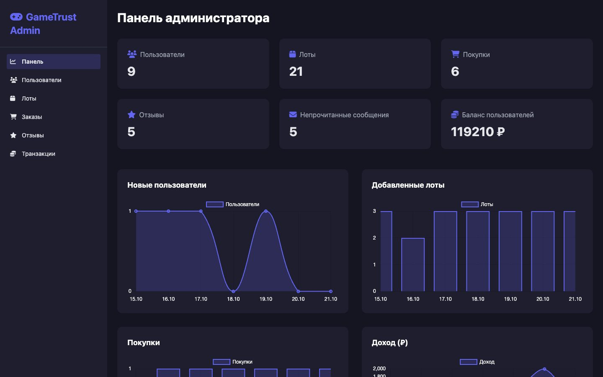

# GameTrust

Маркетплейс игровых товаров: ключей, аккаунтов, валюты и услуг. Деньги покупателя не
уходят продавцу сразу. Они лежат на удержании, пока покупатель не подтвердит, что
получил товар. Учебная практика в колледже, 2025.



|  |  |
|---|---|
| Каталог игры с фильтрами | Страница лота |
|  |  |
| Заказ: товар выдан, ждёт подтверждения | Баланс и история операций |
|  |  |
| Чат с продавцом | Панель администратора |

## Зачем

<!-- ✍️ ТВОЙ ТЕКСТ. 2–4 предложения: почему маркетплейс с гарантом, что хотелось
     попробовать сделать (деньги, чат, 2FA). Удали этот комментарий, когда напишешь. -->

## Что умеет

- **Лоты** по играм и категориям, фильтры по платформе, сортировка, пагинация.
- **Сделка через гаранта.** Деньги списываются с покупателя и висят у продавца на
  удержании. Продавец получает их после подтверждения покупателем или администратором.
  Администратор может вернуть деньги покупателю.
- **Автовыдача.** Продавец загружает ключи, они хранятся зашифрованными (Fernet).
  Покупатель получает следующий ключ сразу после оплаты.
- **Баланс:** пополнение (оплата имитируется), вывод с отменой, история операций.
- **Чат** покупателя с продавцом, о покупке приходит системное сообщение.
- Отзывы и рейтинг продавца, двухфакторный вход (TOTP + резервные коды),
  подтверждение почты, блокировка пользователей.
- **Админка:** статистика за неделю, пользователи, лоты, заказы, игры, переписки.

## Как устроены деньги

```
покупка ──▶ balance покупателя −цена ──▶ hold_balance продавца +цена
                                           │
              подтверждение получения ─────┼──▶ balance продавца +цена
              возврат администратором ─────┴──▶ balance покупателя +цена
```

Все операции с деньгами собраны в [`escrow.py`](escrow.py). Баланс меняется одним
запросом `UPDATE ... SET balance = balance - :цена WHERE balance >= :цена`. Если два
запроса на покупку придут одновременно, второй не уведёт баланс в минус, даже если
оба успели прочитать старое значение. Лот на время покупки блокируется
(`SELECT ... FOR UPDATE` в Postgres), так что последний экземпляр не продастся дважды.

## Безопасность

- CSRF-токены на всех формах и в запросах чата (Flask-WTF).
- Сообщения в чате выводятся как текст, а не как HTML. В системных сообщениях
  экранируется всё, что ввёл пользователь.
- Аватары и картинки лотов принимаются только как изображения и сохраняются
  под случайными именами.
- Ограничение частоты запросов на вход, регистрацию, создание лотов и отправку
  сообщений (Flask-Limiter, счётчики в Redis).
- Главная страница кэшируется в Redis только для гостей: в шапке залогиненного
  пользователя его имя и баланс.

## Что было сложно

<!-- ✍️ ТВОЙ ТЕКСТ. 2–4 пункта: проблема → как решил. Например (если правда было):
     - как держать деньги до подтверждения и не потерять их при возврате;
     - автовыдача: хранить ключи зашифрованными и выдавать по одному;
     - 2FA с резервными кодами;
     - кэш главной в Redis.
     Удали этот комментарий, когда напишешь. -->

## Стек

Python 3.12, Flask, SQLAlchemy 2, Alembic (Flask-Migrate), PostgreSQL / SQLite, Redis,
Flask-Login, Flask-WTF, Flask-Limiter, cryptography (Fernet), pyotp. Шаблоны
Jinja2 + Tailwind + Alpine.js. Docker Compose, gunicorn, GitHub Actions.

## Запуск

```bash
cp .env.example .env    # вписать SECRET_KEY, FERNET_SECRET_KEY, POSTGRES_PASSWORD
docker compose up --build
```

Сайт откроется на http://localhost:5050. При первом запуске база заполняется
демо-данными. Вход: `demo@example.com` / `demo12345`, администратор:
`admin@example.com` / `demo12345`.

Оплата имитируется: при пополнении открывается страница с кнопкой подтверждения.
Без SMTP письмо с подтверждением почты не отправляется, ссылка пишется в лог.

<details>
<summary>Без Docker</summary>

```bash
python3.12 -m venv venv && source venv/bin/activate
pip install -r requirements.txt
export FLASK_APP=app     # переменные — из .env, без DATABASE_URL будет SQLite
flask db upgrade
flask seed
flask run
```
</details>

## Тесты

```bash
pip install -r requirements-dev.txt
pytest
```

26 тестов на SQLite: покупка с удержанием, подтверждение и возврат, вывод и его отмена,
продажа последнего экземпляра, пополнение ради покупки, отрицательные суммы, XSS в чате,
CSRF, кэш главной, загрузка аватара, отзывы. В CI ещё прогоняются миграции и демо-данные
на PostgreSQL и собирается Docker-образ.
